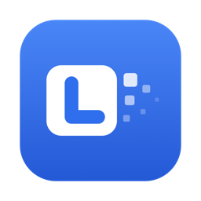
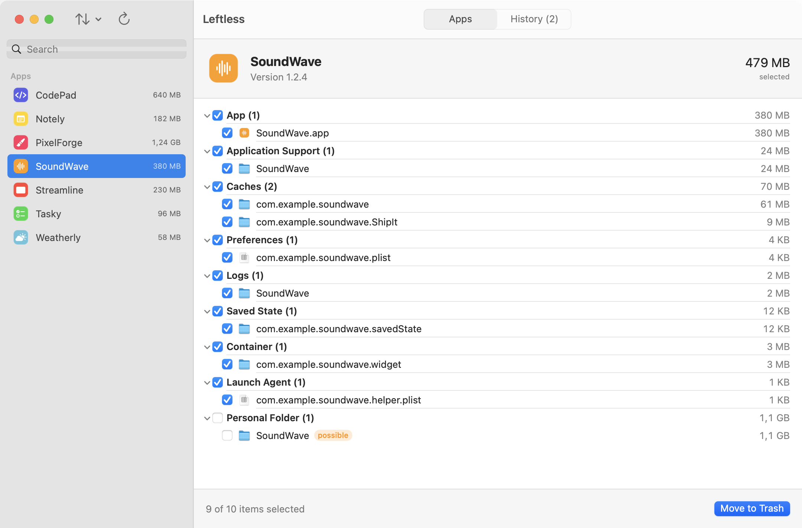
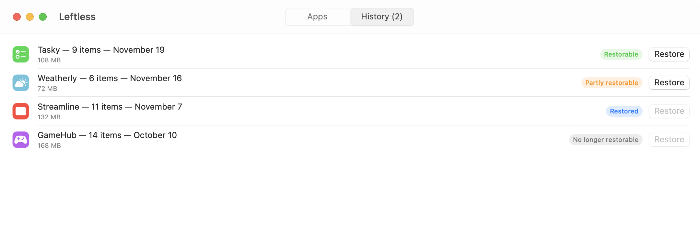
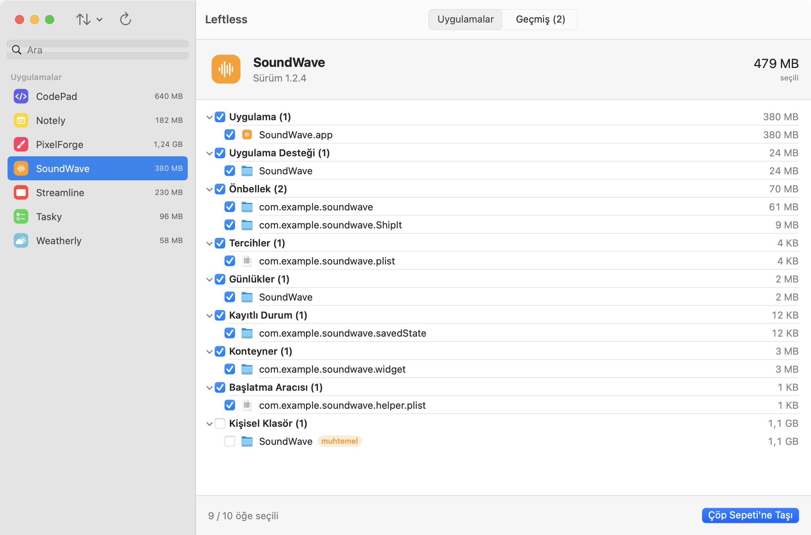

<p align="center">
  
</p>

<h1 align="center">Leftless</h1>

<p align="center">
  <strong>Uninstall Mac apps — and everything they leave behind.</strong><br>
  Caches, preferences, logs, launch agents and more, moved to the Trash together. Every uninstall can be undone.
</p>

<p align="center">
  
  
  
  
</p>

<p align="center">
  <picture>
    <source media="(prefers-color-scheme: dark)" srcset="docs/screenshots/apps-dark.png">
    
  </picture>
</p>

<p align="center"><sub>Screenshots use fictional demo apps.</sub></p>

---

## Why Leftless

Dragging an app to the Trash only removes the `.app`. Its support files, caches, preferences, background helpers and installer files stay on your Mac. Leftless finds them, shows you what they are in plain language, and removes them in one step — without ever deleting anything permanently.

## Features

- **Finds what apps leave behind** — Application Support, Caches, Preferences, Logs, Saved State, Containers and Group Containers, Launch Agents and Daemons, privileged helpers, plug-ins, and files installed by `.pkg` installers.
- **Knows how sure it is** — *certain* items are selected for you; *possible* matches (for example a folder in your Music folder with the same name) stay unselected until you tick them. Folders shared with another app from the same developer are never pre-selected.
- **Nothing is deleted permanently** — everything goes to the Trash, and every uninstall is recorded first.
- **One-click undo** — the History tab puts every item back where it was, including restarting launch agents.
- **Safe by design** — never touches `com.apple.*` items or protected system folders. Files that need administrator rights ask for your password once, through the standard macOS dialog.
- **Easy to use** — pick an app from the list or drag it onto the window or the Dock icon. Search and sort by name or size.
- **Speaks your language** — English, Türkçe, Deutsch, Français, Español, 日本語 and Português (Brasil). Leftless follows your system language.

<p align="center">
  
</p>

## Install

Leftless is not on the App Store yet; build it from source (Xcode 16 or later):

```sh
git clone https://github.com/celikkalper/Leftless.git
cd Leftless
./scripts/build-universal.sh
ditto build/Leftless.app /Applications/Leftless.app
```

Then open Leftless from Launchpad or the Applications folder.

### Full Disk Access

Some folders (Containers, Mail and Safari data and so on) can only be searched with Full Disk Access. Leftless walks you through it on first launch:

1. Open **System Settings → Privacy & Security → Full Disk Access**.
2. Click **+**, add Leftless and turn it on.
3. Restart Leftless.

Without it Leftless still works, skips those places and tells you what it couldn't search.

> **Upgrading from Kalıntısız?** The app was renamed and its bundle ID changed to `com.leftless.app`, so grant Full Disk Access again. Your History moves over automatically on first launch.

## How it works

1. **Scan** — Leftless reads the app's bundle ID, name and developer team, then looks for matching items in the standard Library locations, in launchd job definitions (by the program they run, not just by file name), and in installer receipts.
2. **Review** — results are grouped by kind with sizes. Certain items are ticked; possible items are not.
3. **Move to Trash** — if the app is running, Leftless offers to quit it first. A history record is written *before* anything moves; items needing admin rights move in a single password prompt.
4. **Undo anytime** — while the items are still in the Trash, **History → Restore** puts them back. Once the Trash is emptied, the record shows as no longer restorable.

## Development

| Task | Command |
|---|---|
| Open in Xcode | open `Leftless.xcodeproj`, choose the **Leftless** scheme, press **⌘R** |
| Run the tests | `swift test` |
| End-to-end test (creates and removes a fake app in `~/Applications`) | `LEFTLESS_E2E=1 swift test --filter EndToEnd` |
| Universal release build | `./scripts/build-universal.sh` → `build/Leftless.app` |
| Regenerate the Xcode project after editing `project.yml` | `xcodegen generate` |
| Re-render the app icon | `swift scripts/render-icon.swift <out.png>` |

Project layout:

```
Sources/LeftlessCore   scanning, uninstall, restore, history (UI-free, unit-tested)
Sources/Leftless       SwiftUI app
Tests/LeftlessCoreTests
App/                   Info.plist, entitlements, asset catalog, InfoPlist strings
scripts/               build-universal.sh, render-icon.swift
docs/                  design specs, plans, screenshots
```

### Translations

Strings live in String Catalogs with English keys: `Sources/Leftless/Localizable.xcstrings` (app), `Sources/LeftlessCore/Localizable.xcstrings` (core) and `App/InfoPlist.xcstrings`. `LocalizationCatalogTests` fails if a key is missing a language or a count string lacks plural forms. Translations were written by Claude; native-speaker review is welcome.

Under `swift run` the catalogs are not compiled, so the app shows English; build with Xcode to see translations. After adding strings outside the Xcode IDE, merge the new keys:

```sh
xcodebuild -project Leftless.xcodeproj -scheme Leftless -destination 'platform=macOS' build
xcrun xcstringstool sync Sources/Leftless/Localizable.xcstrings \
  --stringsdata ~/Library/Developer/Xcode/DerivedData/Leftless-*/Build/Intermediates.noindex/Leftless.build/Debug/Leftless.build/Objects-normal/*/*.stringsdata
```

### Screenshots

The images in `docs/screenshots` are rendered from fictional demo data by a Debug-only mode, so no real apps or personal files appear:

```sh
xcodebuild -project Leftless.xcodeproj -scheme Leftless -configuration Debug \
  -derivedDataPath build/DD-debug CODE_SIGNING_ALLOWED=NO build
build/DD-debug/Build/Products/Debug/Leftless.app/Contents/MacOS/Leftless \
  --screenshots /tmp/leftless-shots -AppleLanguages "(en)"
```

### Distribution

`build-universal.sh` produces an ad-hoc signed app that opens without warnings only on the Mac that built it. To share Leftless with other Macs it must be signed with a **Developer ID** and **notarized** by Apple.

---

## Türkçe

**Leftless**, Mac uygulamalarını geride bıraktıkları her şeyle birlikte kaldırır: önbellekler, tercihler, günlükler, arka plan servisleri ve kurulum dosyaları. Hepsi birlikte Çöp Sepeti'ne taşınır, hiçbir şey kalıcı olarak silinmez ve her kaldırma **Geçmiş** sekmesinden tek tıkla geri alınabilir.

<p align="center">
  
</p>

**Kurulum:** Yukarıdaki *Install* bölümündeki dört komutu çalıştırın, ardından Leftless'i Launchpad'den açın. İlk açılışta ekrandaki adımlarla **Tam Disk Erişimi** verin (Sistem Ayarları → Gizlilik ve Güvenlik → Tam Disk Erişimi). Kalıntısız'dan geçiyorsanız izni Leftless için yeniden vermeniz gerekir; Geçmiş kayıtlarınız otomatik taşınır.

**Nasıl çalışır:** Listeden bir uygulama seçin ya da pencereye sürükleyin. *Kesin* öğeler işaretli gelir; *muhtemel* eşleşmeler siz işaretleyene kadar işaretsiz kalır. **Çöp Sepeti'ne Taşı** dediğinizde önce kayıt yazılır, sonra dosyalar taşınır. Çöp Sepeti boşaltılmadığı sürece **Geçmiş → Geri Yükle** her şeyi eski yerine koyar.

**Dil:** Leftless sistem dilinizi kullanır. Yalnızca Leftless'in dilini değiştirmek için: Sistem Ayarları → Genel → Dil ve Bölge → Uygulamalar.
